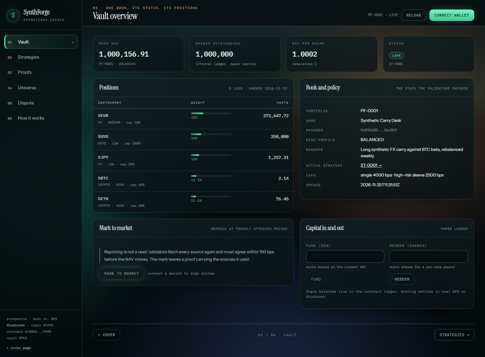
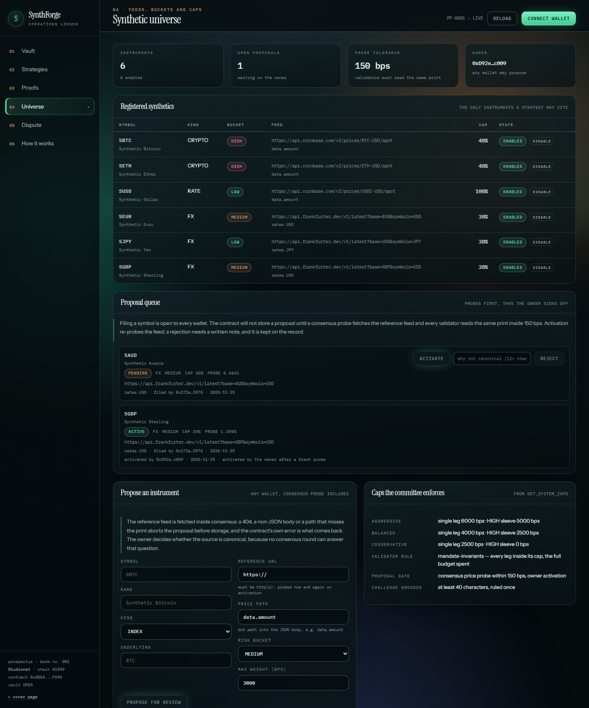

# SynthForge

**Generative synthetic asset vaults, settled on GenLayer.**

An intelligent contract that turns an investment thesis into a synthetic asset portfolio,
executes the rebalance against attested price feeds, and anchors every proposal, fill and
challenge as an execution proof that anyone can re-verify.

| | |
| --- | --- |
| Network | Studionet · chain `61999` |
| Contract | [`0xDB6ABF2b2716959D79fFFD8dc2Be508b506cF696`](https://explorer-studio.genlayer.com/address/0xDB6ABF2b2716959D79fFFD8dc2Be508b506cF696) |
| Deploy tx | [`0x66282a5a…74dea7`](https://explorer-studio.genlayer.com/tx/0x66282a5a0f368d01e079e2e1b731c7ac6d75629d878837f53af0152dcd74dea7) |
| Runner | `py-genlayer:1jb45aa8ynh2a9c9xn3b7qqh8sm5q93hwfp7jqmwsfhh8jpz09h6` |
| Seeded state | 6 instruments · 1 portfolio (`PF-0001`, 1,000,000 GEN paper capital) · 5 proofs |
| Registry | 2 symbols filed by a non-owner wallet: 1 activated, 1 still pending |
| Direct tests | 79 passing (`pytest tests/direct`) |

That deployed contract was not read from a fixture: every row below ran against it on
Studionet, in this order.

| Stage | Result on the live vault |
| --- | --- |
| `register_asset` ×5 | `SBTC`, `SETH`, `SUSD`, `SEUR`, `SJPY` with their real feeds |
| `open_portfolio` | `PF-0001` · BALANCED · 1,000,000 GEN paper capital |
| `generate_strategy` | `ST-0001` accepted by the committee: `RISK_ON`, 5 legs, confidence 60% |
| `execute_strategy` | 5 legs filled at attested prints, 5000 bps turnover |
| `mark_to_market` | NAV 1,000,000 → 1,000,156.91 GEN |
| `challenge_strategy` | ruled `UPHOLD` - one adjudication, recorded on `PR-0005` |
| `propose_asset` SGBP | filed by `0x172a…D976` (not the owner), stored `PENDING` at `1.3098` |
| `activate_asset` SGBP | owner re-probed the feed and activated it; universe is now 6 |
| `propose_asset` SAUD | filed by the same outside wallet, still `PENDING` at `0.6641` |

The paths a symbol may *not* take were tested on the same address, and each one failed with
the contract's own message, not a generic revert:

| Attempt | Live response |
| --- | --- |
| outside wallet calls `activate_asset` | `[EXPECTED] only the vault owner can activate a proposed asset` |
| file `SBTC` again | `[EXPECTED] asset already registered: SBTC` |
| file a symbol whose feed 404s | `[EXTERNAL] feed rejected the request (404)` - nothing stored |
| activate an already-active symbol | `[EXPECTED] asset already registered: SGBP` |
| reject with a one-word note | `[EXPECTED] rejection note must say why, at least 12 characters` |





---

## Ringkasan (ID)

SynthForge adalah vault aset sintetis di GenLayer: satu thesis masuk, komite validator
GenLayer yang menyusun portofolio, mengeksekusinya dengan harga yang di-attest di dalam
konsensus, lalu siapa pun bisa *challenge* alokasi yang melanggar mandat. Semua keputusan
AI tidak dipercaya begitu saja: validator menghitung ulang mandatnya (cap per instrumen,
total 10.000 bps, regime yang dikenal) dan menolak buku yang melanggar, lalu setiap transisi
state meninggalkan *execution proof* on-chain yang bisa diaudit.

Registry-nya juga tidak lagi milik owner saja: **siapa pun boleh mengajukan simbol**, tapi
kontrak baru menyimpannya setelah probe harga lolos konsensus (feed harus menjawab dan
semua validator membaca angka yang sama). Owner yang memutuskan apakah sumber itu kanonik,
dan keputusan itu tersimpan bersama catatannya - bukan disamarkan sebagai perhitungan.

Persetujuan tidak berhenti di "setuju/tidak": putusan challenge harus sepakat pada
**verdict** dan pada **alasan** yang dikutip, dan alasan itu diambil dari daftar kode
tertutup supaya dua node independen tidak pernah berbeda kata. Pelanggaran objektif (cap,
total bobot, instrumen yang dinonaktifkan) dihitung di Python sebelum model bicara, jadi
`REVOKE` tetap bisa dicapai konsensus walaupun model ingin `UPHOLD`.

---

## The problem it solves

AI portfolio agents today are a black box: a model proposes an allocation off-chain, a server
executes it, and the user has to trust both. There is no way to check whether the model saw
the price it claims to have seen, whether the weights it reports are the weights it bought,
or whether the mandate it was given was the mandate it followed.

SynthForge moves that entire loop on-chain and makes each step *comparatively verifiable*:

1. **The proposal is judged, not taken.** The leader asks a model for an allocation; every
   validator recomputes the mandate the book has to satisfy - caps, the 10,000 bps budget, a
   known regime, a known instrument set - and accepts only a book that already obeys it.
   Disagreement is a consensus failure, not a silent overwrite.
2. **Prices are read inside consensus.** Every leg is filled at a price fetched and agreed
   on by the committee, so the fill price cannot be spoofed by the leader.
3. **The mandate is enforced by code, not by the prompt.** Whatever the model returns is
   normalised and clamped against per-instrument caps and the risk-profile ceiling before a
   single unit is booked, and validators refuse any book that needed clamping.
4. **Disputes are adjudicated on-chain, on stated grounds.** Anyone can challenge a live
   allocation; an independent adjudicator rules `UPHOLD` or `REVOKE` and must cite the
   breaches from a closed vocabulary. A revoke halts the strategy and drops the portfolio
   into `REVIEW`, which only an explicit, recorded reopen can clear.

## The four consensus paths

Each path is one `gl.vm.run_nondet_unsafe(leader_fn, validator_fn)` block. Nothing that
touches storage, `self`, or `gl.get_contract_at` lives inside a closure; the closures return
plain data and the contract writes afterwards.

### 1. Registry probe (`propose_asset`, `activate_asset`)

A symbol has no price until it exists, and it should not exist because a wallet says so. The
proposal is fetched inside consensus: the leader reads the reference URL and parses the
registered dot path, every validator reads it again, and a 404, a non-JSON body or a missing
key raises `[EXTERNAL]` before anything is stored. `activate_asset` runs the same probe a
second time, because a filing can sit in the queue for days and the owner's claim is that the
feed still answers now. Filing is open to any wallet; the probe is what a wallet cannot fake,
and the owner's decision - is this the canonical source for this underlying? - is recorded
with its note instead of being disguised as a computation.

### 2. Strategy construction (`generate_strategy`)

The leader builds a portfolio from a fixed universe snapshot:

```
PORTFOLIO CONSTRUCTION ENGINE  →  { regime, weights{symbol: bps}, rationale, confidence_bps }
RISK ADJUDICATOR               →  { verdict: UPHOLD|REVOKE, violations[], explanation }
```

| Valid when | Rule |
| --- | --- |
| Regime | one of `RISK_ON` / `NEUTRAL` / `RISK_OFF` |
| Instrument set | at least two legs, every symbol in the pinned universe |
| Weights | sum to exactly `10 000` bps |
| Caps | already binding: `_apply_caps(weights) == weights` |
| Confidence | inside `0 .. 10 000` |

A validator does not re-run the model. Two samples of a stochastic model are not the same
computation, so the first design - leader and validator both generate, then compare within
500 bps - failed on live Studionet exactly when nothing was wrong: the leader stored a legal
book, the validator's independent sample diverged, and the round closed Undetermined. The
equivalence principle is now stated over the *book*: a proposal is valid when it satisfies the
mandate invariants above, which every node can check without sampling. The leader can choose
among legal books; it cannot store an illegal one.

### 3. Price attestation (`execute_strategy`, `mark_to_market`)

Each instrument carries a `reference_url` and a `price_path` (a dotted JSON path such as
`data.amount` or `rates.USD`). Inside consensus the leader fetches every feed; each validator
fetches the same feeds and the two price maps must agree leg by leg:

```
abs(leader_price - validator_price) * 10000 <= PRICE_TOLERANCE_BPS * leader_price   # 150 bps
```

The agreed map is then reduced to a digest (`_specs_digest`) that is stored on the execution
proof, and the same rows are committed as `evidence` (symbol, URL, JSON path, attested
price), so the fill prices used for a rebalance are reproducible after the fact, not just at
the time.

### 4. Adjudication (`challenge_strategy`)

This is the path that needed the most care, because a ruling is a decision *plus its
reasons*. Comparing only the verdict is not enough: two nodes can both say `REVOKE` for
different reasons, and the stored record would then be a different fact on every node.
Comparing free text is worse, because independent runs never phrase the same breach the same
way, so every challenge round would fail to reach consensus and the state change would be
discarded.

SynthForge therefore makes the grounds machine-comparable:

| Code | Meaning |
| --- | --- |
| `CAP_BREACH` | a leg or the HIGH-risk sleeve exceeds its policy cap |
| `SUM_MISMATCH` | the legs do not sum to 10,000 bps |
| `MANDATE_DRIFT` | the book no longer implements the stated mandate |
| `CONCENTRATION_RISK` | exposure is concentrated in correlated instruments |
| `MISSING_HEDGE` | protection the mandate requires is absent |
| `THESIS_CONTRADICTION` | the book contradicts its own thesis |
| `UNSUPPORTED_INSTRUMENT` | a leg is not an enabled instrument |

The equivalence test is the pair `(verdict, set of vocabulary codes)`. Unknown grounds are
dropped on both sides by the same normaliser, so a validator that invents a label still
converges with an honest one. A `REVOKE` that cites nothing is refused with `[LLM_ERROR]`
instead of being stored.

On top of that, `_policy_breaches` computes the objective breaches in Python *before* the model
is called. If the allocation breaks a cap, the sum, or cites a disabled instrument, those
codes are forced into the ruling and the verdict becomes `REVOKE` regardless of what the model
answered. Consensus on a hard fact does not depend on a stochastic model agreeing with itself,
and a model cannot talk the committee out of a cap it can compute.

### Error taxonomy

Closures raise `gl.vm.UserError` with a prefix, and `_handle_leader_error` decides what a
validator should do when the leader failed instead of returning:

| Prefix | Meaning | Validator behaviour |
| --- | --- | --- |
| `[EXPECTED]` | deterministic, business-level rejection | agree only if the message matches exactly |
| `[EXTERNAL]` | deterministic upstream refusal (400/404 from a feed) | same |
| `[TRANSIENT]` | network flake | agree if the validator also failed transiently, else rotate |
| `[LLM_ERROR]` | model returned unusable output | rotate |

## Lifecycle

```
any wallet ─ propose_asset ──┤ consensus feed probe ──► PENDING
                            │
      owner ─ activate_asset ┴─► universe (re-probed at activation)
      owner ─ reject_asset   ──► REJECTED, with a written note kept on record

register_asset (owner) ──┐
                 ├── open_portfolio ──► fund / redeem / transfer shares
                 │            │
                 │            ├── generate_strategy ──► strategy PROPOSED
                 │            │            │
                 │            │            ├── execute_strategy ──► positions + ACTIVE + proof
                 │            │            │            │
                 │            │            │            └── mark_to_market ──► new NAV + proof
                 │            │            │
                 │            │            └── challenge_strategy ──► REVOKED + portfolio REVIEW
                 │            │                          │
                 │            │                          └── reopen_portfolio ──► LIVE + proof
                 │
                 └── set_asset_enabled / set_paused / transfer_ownership  (owner only)
```

Portfolio status is `OPEN` → `LIVE` → `REVIEW` (after a revoke) → `LIVE` (after a recorded
reopen). A strategy is `ACTIVE` the moment consensus stores it - `PROPOSED` is a UI state for a
draft that has not been executed yet - and becomes `REVOKED` after a ruling. A strategy can be ruled on exactly
once (`adjudicated` on the read model), so a settled book cannot be re-litigated into a
different answer by filing the same complaint twice.

## Contract interface

31 public methods: 16 writes, 15 views.

### Writes (16)

| Method | Who | What it does |
| --- | --- | --- |
| `register_asset(symbol, name, kind, underlying, reference_url, price_path, risk_bucket, max_weight_bps)` | owner | adds an instrument without a probe (bootstrap path) |
| `propose_asset(same fields)` | anyone | files a symbol; stored only if the consensus probe lands a price |
| `activate_asset(symbol)` | owner | re-probes the feed and adds the pending symbol to the universe |
| `reject_asset(symbol, note)` | owner | closes a pending proposal with a note of at least 12 characters |
| `set_asset_enabled(symbol, enabled)` | owner | suspends an instrument without deleting its history |
| `set_paused(paused)` | owner | circuit breaker for every write path |
| `transfer_ownership(new_owner)` | owner | ownership handover |
| `open_portfolio(name, mandate, risk_profile, initial_capital_atto)` | anyone | creates a vault, mints shares 1:1 to the creator |
| `fund_portfolio(portfolio_id, amount_atto)` | anyone | deposits at the current NAV per share |
| `redeem_shares(portfolio_id, shares_atto)` | holder | burns shares for cash at the current mark |
| `transfer_shares(portfolio_id, to, shares_atto)` | holder | moves share ownership |
| `generate_strategy(portfolio_id, thesis, horizon_days)` | manager | LLM proposal under consensus |
| `execute_strategy(portfolio_id, strategy_id)` | manager | attested-price rebalance + proof |
| `mark_to_market(portfolio_id)` | anyone | re-marks the book at fresh attested prices |
| `challenge_strategy(portfolio_id, strategy_id, reason)` | anyone | adjudicated dispute + proof |
| `reopen_portfolio(portfolio_id, note)` | manager or owner | explicit way out of `REVIEW`, recorded |

### Views (15)

`get_system_info`, `get_owner`, `list_assets`, `get_asset`, `list_asset_proposals`,
`get_asset_proposal`, `list_portfolios`, `get_portfolio`, `get_positions`, `get_share_balance`,
`list_strategies`, `get_strategy`, `list_proofs`, `get_proof`, `preview_prompt`.

`get_system_info` publishes `validator_mode` (`mandate-invariants`) so a client can say what the
committee enforces instead of guessing at a tolerance it no longer has.

Every view returns `json.dumps(..., sort_keys=True)` so the bytes are deterministic and the
dashboard can diff two reads. `preview_prompt` returns the exact prompt validators will judge
for a given thesis, which is what makes the model call auditable rather than mysterious.

## Execution proofs

One row per state transition that moved money or changed the book — `PORTFOLIO_OPEN`,
`DEPOSIT`, `REDEMPTION`, `STRATEGY_APPROVAL`, `REBALANCE`, `MARK`, `CHALLENGE`, `REOPEN`:

```json
{
  "proof_id": "PR-0005",
  "kind": "CHALLENGE",
  "portfolio_id": "PF-0001",
  "strategy_id": "ST-0001",
  "allocation_digest": "sha256 of the reviewed weights",
  "input_digest": "sha256 of the adjudication prompt",
  "nav_before_atto": 1000081362696000000000000,
  "nav_after_atto": 1000081362696000000000000,
  "weight_l1_bps": 0,
  "verdict": "REVOKE",
  "verdict_detail": "REVOKE [MANDATE_DRIFT,MISSING_HEDGE]: the mandate requires a real long-vol sleeve…",
  "evidence": {
    "violations": ["MANDATE_DRIFT", "MISSING_HEDGE"],
    "allocation": { "SBTC": 1500, "SETH": 1000, "SUSD": 3500, "SEUR": 2000, "SJPY": 2000 },
    "prompt_digest": "176256b3…"
  },
  "executor": "0x0C0Fd005…",
  "created_at": "2026-11-24T05:40:50Z"
}
```

`weight_l1_bps` is the realised turnover the rebalance actually cost the portfolio, and
`nav_before` / `nav_after` frame the value change the rebalance is responsible for. `evidence`
is what makes a proof re-runnable rather than merely descriptive: price proofs carry the
symbol, URL, JSON path and attested price of every leg, rebalance proofs carry the target
weights and turnover, challenge proofs carry the cited grounds and the mandate they were
judged against.

## Quick start

```bash
# 0. prerequisites: Python 3.12, Node >= 22, and the GenLayer CLI
npm install && pip install -r requirements.txt

# 1. run the unit suite (no network, direct mode)
pytest

# 2. deploy and seed the universe on Studionet
node deploy/deployScript.ts

# 3. drive one full lifecycle against the live contract
node deploy/e2eScript.ts --address 0x3B60…3060

# 4. dashboard
cd frontend && npm install && npm run dev
```

`deploy/deployScript.ts` prints the address, seeds five instruments, opens the demo portfolio,
reads the state back and refuses to report success if the read-back is empty (a Studionet
deploy can reach `FINALIZED` and still have rolled back, so the receipt alone is not proof).
It writes `deployments.json`, `frontend/public/fees.json` and `frontend/public/deployment.json`.

### Environment

| Variable | Where | Purpose |
| --- | --- | --- |
| `DEPLOYER_PRIVATE_KEY` | shell | deployer key; otherwise read from `.env` (`GENLAYER_DEV_KEY`) |
| `SYNTHFORGE_KEY_FILE` | shell | explicit path to a key file |
| `SYNTHFORGE_WALLET` | shell | keystore name to deploy with (default `global`) |
| `NEXT_PUBLIC_SYNTHFORGE_ADDRESS` | `frontend/.env.local` | fallback vault address only |

The dashboard resolves its contract from `frontend/public/deployment.json`, which the deploy
script writes, so the page cannot silently point at an older deployment than the one the
README documents.

Studionet charges a fee deposit and genlayer-js sends a zero deposit unless it is told
otherwise, so both drivers price each transaction with `genlayer estimate-fees` once per
process; the browser has no estimator, so the deploy script publishes the snapshot it used to
`frontend/public/fees.json`.

## Frontend

The dashboard is one document with two densities. Both route groups sit on one animated field -
three slow chromatic fields drifting behind a coordinate grid that pans - built in CSS alone, with
no canvas, no images and no JavaScript, and it stops entirely under `prefers-reduced-motion`.
Everything above it is smoked glass: translucent panels, hairline borders, mint for what is
settled, copper for what needs attention, rose for what failed. The six rooms are mounted together
inside one deck, so pressing a room slides the next leaf in from the side instead of replacing the
page: the rail, the masthead and the wallet keep their place, and only the leaf moves. The URL
still names the leaf you are on, so every room can be linked to and reloaded; `←` and `→` walk the
deck, and the hairline foot prints `03 / 06` beside the two ways onward. Same field, same glass,
same serif voice and mono figures throughout, so moving from the cover to the ledger reads as
turning a leaf rather than leaving the product. Only the density changes - the cover breathes and
the desk is packed.

| Route | Leaf | What it is for |
| --- | --- | --- |
| `/` | cover | the instrument: what it claims, the live certificate, the honest limits |
| `/vault` | room | NAV, positions, book policy, mark-to-market, fund/redeem |
| `/strategies` | room | the register of drafts, one draft in full, propose a new one |
| `/proofs` | room | the ledger, filterable, with the evidence behind each row |
| `/universe` | room | feeds, buckets, per-instrument caps, an open proposal queue and the owner's decision |
| `/dispute` | room | file a challenge, read the latest ruling, reopen the book |
| `/how-it-works` | room | the four consensus paths, step by step |

Reads work without a wallet. Writes need one, and every write notice distinguishes
`ACCEPTED` from `FINALIZED`, because a Studionet receipt that has not closed its appeal
window is not a settled transaction.

Connecting a wallet also moves it to Studionet (`61999`), adding the network first if the
wallet has never seen it, and the check runs again at signing time: a wallet left on another
chain is told to switch instead of failing with viem's `chainId should be same as current`.

### Deploy on Vercel

The dashboard is the `frontend/` directory, so Vercel has to be told which directory is the app:

1. [Import the repository](https://vercel.com/new/clone?repository-url=https%3A%2F%2Fgithub.com%2Fweels007%2FSynth-Forge&root-directory=frontend&project-name=synthforge),
   or open Vercel and use **Add New -> Project** on the same repository.
2. Set **Root Directory** to `frontend`. The framework is then detected as Next.js; leave the
   install, build and output commands alone.
3. Deploy. There is nothing else to configure.

[](https://vercel.com/new/clone?repository-url=https%3A%2F%2Fgithub.com%2Fweels007%2FSynth-Forge&root-directory=frontend&project-name=synthforge)

No environment variables are required. The address the dashboard reads is pinned in
`frontend/public/deployment.json`, which the deploy script writes and the browser fetches at
load; `NEXT_PUBLIC_SYNTHFORGE_ADDRESS` exists only as an override for pointing the dashboard at
a different deployment. Nothing in the build needs a secret, a database or a server, so a
preview deployment reads the same live book as production.

Two things change once it is public. Reads go from the visitor's browser straight to the
Studionet RPC, which caps a client at 500 requests an hour, so a busy page can hit that ceiling
before it hits a bug. And writes still need an injected wallet on chain 61999 - the deployed
site is a reader for anyone who arrives without one.

## Repository map

```
contracts/SynthForgeVault.py      the intelligent contract (31 public methods)
tests/direct/                     direct-mode pytest suites (79 tests, mocked web + llm)
scripts/studionet.cjs             shared Studionet driver: paced RPC, receipts, fees
scripts/wallet.mjs                keystore loader for deployers and test actors
scripts/fetchFonts.mjs            re-downloads the dashboard fonts (latin subsets)
deploy/deployScript.ts            deploy + seed + read-back verification
deploy/e2eScript.ts               generate → execute → mark → challenge → reopen, prints proofs
frontend/                         Next.js dashboard: one instrument - cover leaf + a six-leaf deck
docs/ARCHITECTURE.md              why the contract is shaped this way
docs/LICENSE                      MIT
```

## Tests

`pytest` runs in direct mode against `genlayer-test`: no network, deterministic, and the
cheatcodes (`mock_web`, `mock_llm`, `run_validator()`, `expect_revert()`) let a test play
the validator role explicitly.

| Suite | Tests | Covers |
| --- | --- | --- |
| `test_registry_and_portfolios.py` | 20 | symbol rules, caps per profile, funding, redemption, share transfers, pause/ownership guards |
| `test_registry_proposals.py` | 15 | permissionless filing, probe agreement and failure, owner activation, rejection notes, duplicate and re-proposal rules |
| `test_strategy_engine.py` | 14 | proposal normalisation, clamping, prompt content, and the mandate invariants a validator accepts or rejects |
| `test_execution_and_marks.py` | 9 | attested fills, turnover accounting, NAV after rebalance, mark-to-market |
| `test_challenges_and_proofs.py` | 10 | uphold vs revoke, portfolio review state, one ruling per strategy, proof chain integrity |
| `test_consensus_binding.py` | 11 | verdict + grounds equivalence, unknown-ground dropping, objective breaches overriding the model, evidence payloads |

The interesting ones are the validator tests: `run_validator()` is handed a book that breaks a
cap, skips a leg, under-spends the budget, or invents a regime - each is rejected - and a book
that is merely a *different* legal allocation, which is accepted, because that is what the
committee actually promises. `test_consensus_binding.py` goes further and checks that an honest
validator still converges when the leader words its grounds differently or invents a label
outside the vocabulary.

## Design notes

**Why paper capital.** `open_portfolio` mints shares against an internal `atto` balance rather
than accepting GEN. Real settlement would need an oracle for GEN price and a bridge for each
synthetic, which would bury the part that matters (consensus over the strategy) under
plumbing. The accounting is real: shares, NAV per share, funding and redemption all price off
the marked book, so swapping the cash ledger for a real one is a contained change.

**Clamp, do not reject.** A model that returns a weight above the cap is not an error, it is
the expected case, so the contract clamps it and records the adjustment in the proof detail.
Rejecting would make the strategy path fail exactly when the model is most creative. Only
*structural* violations (unknown symbols, weights that sum to zero, malformed JSON) raise.

**Agreement is a predicate, not a distance.** LLM output is not reproducible, and measuring
how close two samples are was the wrong shape for the problem: on live Studionet it rotated
rounds that had produced a perfectly legal book. The contract now defines what a valid book
*is* - a known regime, at least two legs from the pinned universe, weights summing to
10 000 bps, caps already binding, confidence in range - and every node checks the same
predicate. The only numeric tolerance left is 150 bps on prices, where two fetches of the same
source really should agree.

**A closed vocabulary is a consensus primitive, not a style choice.** Free-text grounds make
the consensus set empty, which silently discards the state change. Constraining the model to
seven codes, normalising what it returns, and computing the objective breaches in Python is
what turns "the committee agreed to revoke" into a fact that can be stored once and audited
later.

**The prompt is a view.** `preview_prompt` exists because an AI system that cannot show its
prompt is not auditable. It renders the same string the leader sends.

## Limits

- Prices come from public keyless HTTP feeds (Coinbase spot, Frankfurter FX); a production
  build would need a signed oracle and staleness bounds per instrument.
- Synthetic exposure is not hedged: the vault tracks notional value, it does not hold the
  underlying.
- Share transfer is `u256` bookkeeping, not an ERC-20.
- One portfolio per `open_portfolio` call and a single active strategy per portfolio: the
  model reasons about one book at a time.
- The violation vocabulary is deliberately small. A breach it cannot name is either mapped to
  the nearest code or left to `MANDATE_DRIFT`; widening it is a contract change, not a prompt
  change.

## License

MIT — see `docs/LICENSE`.
